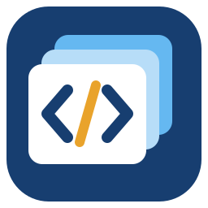

# ScriptDeck

更新日：2026-10-12



ScriptDeckは、HyperCardに着想を得たWindows向けのカード型アプリケーション作成ツールです。
カードにボタン・入力欄・画像などを配置し、JavaScriptで動作を記述します。
Playerで実行し、Magicで画面やプロパティを編集します。

## 保存形式と制作方法

| 形式 | 用途 | コード編集 |
| --- | --- | --- |
| `.deck` | 単独のJSONファイルで制作 | Magic内のエディタ |
| Folder | `main.deck`・外部JS・リソースを分けて制作 | ScriptDeckを終了してVSCodeで編集 |
| `.deckx` | 無圧縮ZIPへまとめて配布・再生 | Magic不可。元のDeckを編集して再Export |

MagicのExportで形式を変換し、画像と`data/`内のファイルを出力先へコピーします。
Playerでの入力などは保存対象です。deckxも内部の`main.deck`を更新して保存します。
詳細は[Deck形式・Folder・deckxとExport](doc/FILE_FORMATS.md)を参照してください。

## 主な機能

- カード・部品の作成、複製、配置、並べ替え、プロパティ編集。
- Button、Field、Text、Image、Listbox、DropdownList、InputBox、Checkbox、RadioButton、TextEditor。
- ボタン・状態変更・カード表示・ファイルドロップのJavaScriptイベント。
- 部品の検索・プロパティ操作・動的作成、カード移動とDeck切り替え。
- ファイル／フォルダ選択、UTF-8・バイナリー入出力、WAV再生、外部プロセス起動。
- PlayerのCtrl+Spaceによるコード実行、`.deck`と`.deckx`のアイコン・関連付け。

## 起動例

`ScriptDeck.exe`は、実際のEXEのパスに置き換えてください。

```bat
rem HomeをPlayerで開く
ScriptDeck.exe

rem 通常Deckを編集（-magicも使用可）
ScriptDeck.exe --magic example.deck

rem Folderを画面編集。コードはVSCodeで編集する
ScriptDeck.exe --magicFolder "C:\Decks\MyDeck"

rem Folder・deckxをPlayerで開く
ScriptDeck.exe "C:\Decks\MyDeck"
ScriptDeck.exe example.deckx

rem GUIを開かずdeckxへExport・検証
ScriptDeck.exe -run example.deck exportDeckx example.deckx
ScriptDeck.exe -run example.deckx validate
```

通常起動でDeck未指定の場合は`%LOCALAPPDATA%\ScriptDeck\home.deck`を開きます。
Homeがなければ内蔵データから作成し、既存Homeは上書きしません。
Player終了時は変更を自動保存し、保存失敗時は終了を止めます。Magicは未保存の破棄確認を表示します。
`-run`は情報取得・JSON出力・検証・コピー・deckxへのExport用で、DeckのJavaScriptは実行しません。

## ビルドとテスト

GUIはWindows x64向けです。Dear ImGui、Direct3D 11、QuickJS-NGを使用します。
依存ライブラリのソースは同梱しています。日本語表示にはWindowsのMeiryoを使用します。

1. Visual Studio 2026に「C++によるデスクトップ開発」とWindows SDKをインストールします。
2. `ScriptDeck.slnx`を開きます（ツールセットv145）。
3. Release / x64を選んでリビルドします。
4. `ScriptDeck/bin/x64/Release/ScriptDeck.exe`を実行します。

CMakeでテストする場合：

```sh
cmake -S ScriptDeck -B build -DBUILD_TESTING=ON
cmake --build build --config Debug
ctest --test-dir build -C Debug --output-on-failure --timeout 30
```

GUIはWindows専用です。非Windows向けにもCLI・モデル・JavaScript・ヘッドレスGUIテストを含みます。
今回のWindowsでの検証内容は[変更履歴](doc/HISTORY.md)を参照してください。

## ドキュメントとサンプル

使い方・APIの入口は[ドキュメント目次](doc/readme.md)です。

- [操作ガイド](doc/USER_GUIDE.md)：起動、Magicの編集、保存、アイコンと関連付け。
- [Deck形式・Export](doc/FILE_FORMATS.md)：通常・Folder・deckx、外部JS、リソース同梱、相対パス。
- [JavaScript・イベント](doc/SCRIPT_API.md)：コードの実行タイミングとイベント。
- [変更履歴](doc/HISTORY.md)：実装と検証の記録。

ソース・プロジェクト・テストは`ScriptDeck/`、サンプルDeckは`sampleDeck/`、説明書は`doc/`にあります。

## ライセンス

ScriptDeck本体は **MIT License** で公開します。著作権表示は `Copyright (c) 2026 bryful` です。[LICENSE](LICENSE) を参照してください。

同梱する第三者コード・データは、それぞれのライセンスに従います。

| コンポーネント | ライセンス |
| --- | --- |
| Dear ImGui 1.91.9b | MIT |
| Dear ImGui同梱のstb、ProggyClean | MIT（stbはMITの選択肢を使用） |
| Dear ImGuiの日本語字形範囲の元データ | CC BY 4.0 |
| QuickJS-NG 0.16.2 | MIT |
| QuickJS-NG同梱のUnicodeデータ | Unicode License V3 |
| nlohmann/json 3.12.0 | MIT |

著作権表示とライセンス全文・帰属情報は [THIRD_PARTY_NOTICES.md](THIRD_PARTY_NOTICES.md) にまとめています。バイナリーを配布する場合も、`LICENSE` と `THIRD_PARTY_NOTICES.md` を同梱してください。

## VSCode拡張

Folder Deckのコード編集用に[VSCode拡張](vscode-scriptdeck/README.md)を用意しています。再生・Magic・エクスポート、Deckツリー、API補完に対応します。

VSIXをインストール後、「ScriptDeck: ScriptDeck.exeを登録」で実行ファイルを選択してください。`scriptdeck.executablePath`が未設定なら、新規作成・再生・Magic・エクスポート時に選択ダイアログを表示します。キャンセルした場合は操作を中止します。
